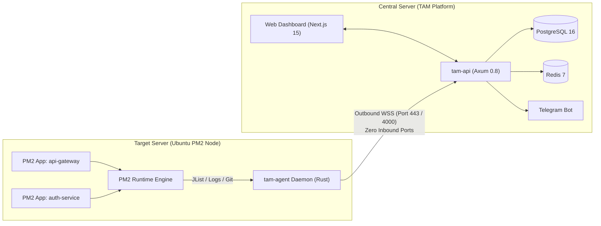

# Panduan Kebutuhan Server & Deployment Ubuntu PM2 Monitoring (`tam-agent`)

Dokumen ini menjelaskan **kebutuhan lengkap server** (spesifikasi hardware, sistem operasi, software dependensi, perizinan, dan jaringan) untuk menjalankan platform **TAM (Traffic & Application Monitoring)**, baik untuk **Target Server Ubuntu (Node PM2)** maupun **Central Platform Server (TAM API & Dashboard)**.

---

## 1. Peran & Topologi Server

Dalam arsitektur TAM, terdapat dua peran server:

1. **Target Server (Ubuntu PM2 Node)**: Server Ubuntu tempat aplikasi Node.js/PM2 berjalan. Pada server ini hanya dipasang daemon ringan `tam-agent` (dibangun dengan Rust, konsumsi memory < 30 MB).
2. **Central Platform Server (TAM Central)**: Server pusat yang menjalankan backend API (`tam-api`), PostgreSQL 16, Redis 7, dan Web Operations Dashboard (`apps/web` Next.js 15).



---

## 2. Matriks Spesifikasi Hardware

### A. Target Server (Ubuntu PM2 Node)
`tam-agent` dirancang ultra-ringan menggunakan Rust murni tanpa runtime tambahan (overhead CPU < 0.5%, RAM < 30 MB).

| Komponen | Spesifikasi Minimal | Rekomendasi Produksi | Catatan |
| :--- | :--- | :--- | :--- |
| **CPU** | 1 vCPU (x86_64 atau ARM64) | 2+ vCPU | Overhead agent tidak membebani proses PM2 |
| **RAM** | 1 GB (sistem + agent) | 2 GB - 4 GB+ | Agent hanya menggunakan 15–30 MB RSS |
| **Disk Storage** | 10 GB free space | 20 GB+ SSD | Digunakan untuk log PM2 (`~/.pm2/logs`) |
| **Arsitektur CPU** | `x86_64` (amd64) atau `aarch64` (arm64) | `x86_64` / `aarch64` | Didukung penuh via binary musl/glibc |
| **Network Egress** | 10 Mbps outbound | 100 Mbps+ outbound | Telemetry interval 3s (~2 KB per payload) |

### B. Central Platform Server (TAM API, DB, Redis & Web)
Spesifikasi untuk server pusat monitoring (dapat mengelola hingga 100+ target node).

| Komponen | Spesifikasi Minimal (< 10 Node) | Rekomendasi (10–100+ Node) |
| :--- | :--- | :--- |
| **CPU** | 2 vCPU | 4–8 vCPU |
| **RAM** | 4 GB | 8–16 GB |
| **Disk Storage** | 25 GB SSD | 100 GB+ NVMe SSD (PostgreSQL time-series data) |
| **Network** | 100 Mbps inbound/outbound | 1 Gbps inbound/outbound |

---

## 3. Kebutuhan Sistem Operasi & Dependensi Software

### A. Kebutuhan pada Target Server (Ubuntu PM2 Node)

#### 1. Sistem Operasi yang Didukung
- **Ubuntu 24.04 LTS (Noble Numbat)**
- **Ubuntu 22.04 LTS (Jammy Jellyfish)**
- **Ubuntu 20.04 LTS (Focal Fossa)**
- *Linux Kernel:* Versi `5.4` atau yang lebih baru (`uname -r`).

#### 2. Dependensi Software Wajib
1. **Node.js**: Versi `18.x`, `20.x`, atau `22.x LTS`.
   ```bash
   node -v  # Harus terpasang
   ```
2. **PM2 Process Manager**: Versi `5.x` terpasang global.
   ```bash
   pm2 -v   # Harus terpasang global via npm
   ```
3. **Git CLI**: Digunakan oleh agent untuk membaca active branch dan commit hash dari direktori kerja aplikasi.
   ```bash
   git --version
   ```
4. **Systemd**: Standard init system Ubuntu untuk mengelola background service (`systemctl`).
5. **Paket Utilitas Dasar Ubuntu**:
   ```bash
   sudo apt-get update && sudo apt-get install -y curl wget ca-certificates jq
   ```

#### 3. Instalasi Node.js & PM2 (Jika Belum Ada)
Jika server Ubuntu Anda belum memiliki Node.js dan PM2:
```bash
# Pasang Node.js 20.x LTS via NodeSource
curl -fsSL https://deb.nodesource.com/setup_20.x | sudo -E bash -
sudo apt-get install -y nodejs

# Pasang PM2 secara global
sudo npm install -g pm2

# Setup startup script agar PM2 otomatis hidup setelah reboot
sudo pm2 startup systemd -u $USER --hp $HOME
```

---

## 4. Kebutuhan Jaringan & Konfigurasi Firewall (UFW)

### Matriks Port & Arah Lalu Lintas

| Arah Trafik | Server | Port / Protokol | Tujuan / Keterangan |
| :--- | :--- | :--- | :--- |
| **Outbound (Egress)** | Target Node | Port `443` (WSS) atau `4000` (WS) | Menghubungi TAM Central Server (`/ws/agent`) |
| **Inbound (Ingress)** | Target Node | **TIDAK ADA (0 PORT)** | Target server aman dari scanning port luar |
| **Inbound (Ingress)** | Central Server | Port `4000` TCP | Akses API & WebSocket Agen |
| **Inbound (Ingress)** | Central Server | Port `3000` TCP | Akses Dashboard Next.js (bila tanpa proxy) |
| **Inbound (Ingress)** | Central Server | Port `80` & `443` TCP | Reverse Proxy Nginx/Caddy (HTTPS/WSS) |
| **Internal Only** | Central Server | Port `5433` (Postgres), `6380` (Redis) | Hanya listen di `127.0.0.1` / Docker Network |

### Konfigurasi Firewall UFW pada Target Server (PM2 Node)
Karena agent menggunakan koneksi **outbound persistent WebSocket**, tidak perlu membuka port masuk apa pun untuk TAM:
```bash
# Pastikan lalu lintas outbound diizinkan (default Ubuntu)
sudo ufw default allow outgoing
sudo ufw default deny incoming

# Buka hanya port SSH Anda (misal 22) dan port web app Anda (misal 80/443)
sudo ufw allow 22/tcp
sudo ufw allow 80/tcp
sudo ufw allow 443/tcp
sudo ufw enable
```

### Konfigurasi Domain & Nginx Reverse Proxy (WSS) pada Central Server
Sangat disarankan membungkus central TAM API dengan Nginx + SSL (Let's Encrypt) agar koneksi WebSocket menggunakan `wss://`:

```nginx
# /etc/nginx/sites-available/tam.yourdomain.com
map $http_upgrade $connection_upgrade {
    default upgrade;
    ''      close;
}

server {
    server_name tam.yourdomain.com;

    # Frontend Dashboard Next.js
    location / {
        proxy_pass http://127.0.0.1:3000;
        proxy_http_version 1.1;
        proxy_set_header Host $host;
        proxy_set_header X-Real-IP $remote_addr;
        proxy_set_header X-Forwarded-For $proxy_add_x_forwarded_for;
        proxy_set_header X-Forwarded-Proto $scheme;
    }

    # Central REST API
    location /api/ {
        proxy_pass http://127.0.0.1:4000;
        proxy_http_version 1.1;
        proxy_set_header Host $host;
        proxy_set_header X-Real-IP $remote_addr;
    }

    # WebSocket Hubs (/ws/agent & /ws/live)
    location /ws/ {
        proxy_pass http://127.0.0.1:4000;
        proxy_http_version 1.1;
        proxy_set_header Upgrade $http_upgrade;
        proxy_set_header Connection $connection_upgrade;
        proxy_set_header Host $host;
        proxy_set_header X-Real-IP $remote_addr;
        proxy_read_timeout 86400s;
        proxy_send_timeout 86400s;
    }

    listen 443 ssl http2;
    # ssl_certificate /etc/letsencrypt/live/tam.yourdomain.com/fullchain.pem;
    # ssl_certificate_key /etc/letsencrypt/live/tam.yourdomain.com/privkey.pem;
}
```

---

## 5. Hak Akses, User & Izin Operasional

PM2 dapat berjalan di bawah user `root` atau user non-root (seperti `ubuntu`, `deploy`, atau `www-data`). Konfigurasi permission harus disesuaikan:

### Skenario A: PM2 Dijalankan oleh User Non-Root (Rekomendasi Terbaik)
Jika proses PM2 Anda berjalan di bawah user non-root (misal user `ubuntu`):
1. **Service User**: Jalankan `tam-agent` di bawah user yang sama (`User=ubuntu`) atau pastikan agent dapat mengakses direktori `~/.pm2`.
2. **Environment Variable `PM2_HOME`**: Berikan path direktori PM2 secara eksplisit:
   ```ini
   Environment="PM2_HOME=/home/ubuntu/.pm2"
   ```
3. **PATH Node.js**: Pastikan path binary `node` dan `pm2` tercantum dalam environment service:
   ```ini
   Environment="PATH=/usr/local/bin:/usr/bin:/bin:/home/ubuntu/.nvm/versions/node/v20.18.0/bin"
   ```

### Skenario B: PM2 Dijalankan oleh User `root`
Jika PM2 berjalan di bawah user `root`, service systemd dapat menggunakan `User=root` dan default `PM2_HOME=/root/.pm2`.

---

## 6. Pre-flight Checklist (Skrip Verifikasi Kesiapan Server)

Simpan skrip verifikasi berikut di target server Ubuntu untuk mengecek kesiapan sebelum instalasi:

```bash
cat << 'EOF' > check-server-prerequisites.sh
#!/usr/bin/env bash
echo "=== TAM Target Server Pre-Flight Check ==="

# 1. OS Version
if [ -f /etc/os-release ]; then
    . /etc/os-release
    echo "✔ OS: $PRETTY_NAME"
else
    echo "✖ OS: Bukan Ubuntu/Debian yang dikenali"
fi

# 2. Kernel
echo "✔ Kernel: $(uname -r)"

# 3. Node.js
if command -v node >/dev/null 2>&1; then
    echo "✔ Node.js: $(node -v)"
else
    echo "✖ Node.js belum terinstall (Wajib v18/v20/v22)"
fi

# 4. PM2
if command -v pm2 >/dev/null 2>&1; then
    echo "✔ PM2: $(pm2 -v)"
    echo "  Status proses PM2 saat ini:"
    pm2 jlist | jq '.[].name' 2>/dev/null || echo "  (Belum ada aplikasi PM2 yang berjalan)"
else
    echo "✖ PM2 belum terinstall (Wajib: npm install -g pm2)"
fi

# 5. Git
if command -v git >/dev/null 2>&1; then
    echo "✔ Git: $(git --version)"
else
    echo "✖ Git belum terinstall (sudo apt install -y git)"
fi

# 6. Memory & Disk
FREE_RAM=$(free -m | awk '/^Mem:/{print $7}')
DISK_AVAIL=$(df -h / | awk 'NR==2 {print $4}')
echo "✔ RAM Tersedia: ${FREE_RAM}MB (Minimal 200MB free)"
echo "✔ Disk Tersedia: ${DISK_AVAIL}"

echo "=========================================="
EOF
chmod +x check-server-prerequisites.sh
./check-server-prerequisites.sh
```

---

## 7. Instalasi & Konfigurasi `tam-agent`

### Langkah 1: Pasang Binary `tam-agent`
Kompilasi binary untuk Linux (x86_64 atau ARM64) atau unduh dari rilis repository:
```bash
# Salin binary ke lokasi eksekusi sistem
sudo cp target/release/tam-agent /usr/local/bin/tam-agent
sudo chmod +x /usr/local/bin/tam-agent

# Verifikasi binary
/usr/local/bin/tam-agent --version || echo "Binary OK"
```

### Langkah 2: Buat File Unit Systemd
Buat file `/etc/systemd/system/tam-agent.service`:

```ini
[Unit]
Description=TAM Telemetry & PM2 Monitoring Daemon
After=network.target pm2-root.service
Wants=network-online.target

[Service]
Type=simple
# Sesuaikan user pemilik proses PM2 (misal: ubuntu atau root)
User=ubuntu
Group=ubuntu
WorkingDirectory=/home/ubuntu

# Konfigurasi Identitas Server & API TAM
Environment="TAM_SERVER_ID=srv-ubuntu-prod-01"
Environment="TAM_ENVIRONMENT=production"
Environment="TAM_WS_URL=wss://tam.yourdomain.com/ws/agent"
Environment="TAM_AGENT_TOKEN=tam_agent_secret_token_2026"
Environment="PM2_HOME=/home/ubuntu/.pm2"
Environment="PATH=/usr/local/bin:/usr/bin:/bin:/home/ubuntu/.nvm/versions/node/v20.18.0/bin"

ExecStart=/usr/local/bin/tam-agent run
Restart=always
RestartSec=5
LimitNOFILE=65536

# Isolasi Keamanan Systemd
ProtectSystem=full
ProtectHome=read-only
ReadWritePaths=/home/ubuntu/.pm2/logs

[Install]
WantedBy=multi-user.target
```

### Langkah 3: Aktifkan dan Jalankan Daemon
```bash
sudo systemctl daemon-reload
sudo systemctl enable --now tam-agent
```

---

## 8. Verifikasi & Diagnostik Operasional

1. **Cek Status Service**:
   ```bash
   sudo systemctl status tam-agent
   ```
   *Output normal:* `Active: active (running)`

2. **Periksa Live Log Stream**:
   ```bash
   sudo journalctl -u tam-agent -f
   ```
   *Log yang diharapkan:*
   ```text
   Connecting to TAM API server at wss://tam.yourdomain.com/ws/agent...
   Connected to TAM API server successfully
   ```

3. **Uji Perintah Remote dari Web UI**:
   - Buka Dashboard TAM di browser.
   - Buka menu **PM2 Fleet**, pilih server, klik **Restart** pada salah satu aplikasi.
   - Periksa `journalctl -u tam-agent -f` untuk memastikan perintah diterima dan dieksekusi tanpa error.

---

## 9. Tuning Kernel Ubuntu untuk Skala Besar (Opsional)

Untuk server produksi berkapasitas ribuan koneksi:
Tambahkan ke `/etc/sysctl.d/99-tam-monitoring.conf`:
```ini
# Meningkatkan batas socket backlog
net.core.somaxconn = 65535
net.ipv4.tcp_max_syn_backlog = 65535

# Optimasi TCP Keepalive untuk koneksi WebSocket stabil
net.ipv4.tcp_keepalive_time = 300
net.ipv4.tcp_keepalive_intvl = 15
net.ipv4.tcp_keepalive_probes = 5

# Batas file descriptors global
fs.file-max = 2097152
```
Terapkan dengan:
```bash
sudo sysctl --system
```
