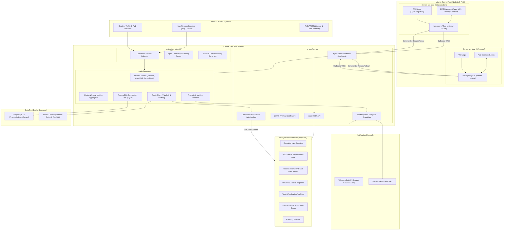

# TAM Traffic & Server Fleet Monitoring System Specification

## 1. Executive Summary & Objectives
**TAM (Traffic Activity & Application Monitoring)** is an enterprise-grade, multi-tenant traffic and server fleet monitoring platform engineered with a high-performance **Rust** backend and a modern **Next.js 15** executive dashboard.

TAM bridges low-level network infrastructure telemetry (bandwidth, packet distributions, protocol breakdowns, connection state) and high-level web application analytics (endpoint latency, error rates, active user sessions) with **deep Ubuntu Server & PM2 Process Fleet Management**:
- Real-time PM2 process health tracking (CPU %, RAM, status, uptime, restarts).
- Live stdout/stderr log streaming per PM2 process.
- Bi-directional remote process lifecycle management (Restart, Stop, Reload, Clear Logs with audit logging).
- Application Git & runtime metadata extraction (branch, commit hash, commit message, Node.js version).
- Multi-server cluster grouping by environment (`production`, `staging`, `development`).
- Instant incident alerts via **Telegram Bot API** and Webhooks on process crash, restart loops, server disconnection, and traffic anomalies.

---

## 2. System Architecture

---

## 3. Crate Breakdown & Modules

### 3.1 `crates/tam-core` (Shared Kernel)
- **Domain Models**:
  - `ServerNode`: Node ID, hostname, IP address, environment (`production`, `staging`, `development`), OS details, CPU cores, total RAM, disk usage, agent version, last heartbeat, status (`online`, `offline`).
  - `Pm2ProcessMetrics`: Process ID, name, PM2 ID, status (`online`, `stopping`, `stopped`, `errored`), CPU %, RAM bytes, uptime seconds, restart count, memory limit, Git branch, commit hash, commit message, Node.js version.
  - `Pm2Command`: Command ID, target node ID, target PM2 ID/name, action (`restart`, `reload`, `stop`, `clear_logs`), issuer user, timestamp, status (`pending`, `executed`, `failed`), error message.
  - `NetworkPacketEvent`: Timestamp, source IP/port, destination IP/port, protocol (TCP/UDP/ICMP/DNS/HTTP), packet size bytes, flags, latency ms.
  - `AppRequestEvent`: Timestamp, client IP, method, path, status code (2xx/3xx/4xx/5xx), duration ms, user-agent.
  - `AlertEvent`: Alert ID, category (`pm2_crash`, `node_offline`, `bandwidth_spike`, `error_rate`), severity (`info`, `warning`, `critical`), node/app target, description, timestamp, resolved status.
- **Storage & Migrations**:
  - PostgreSQL schema for servers, PM2 snapshots, process audit logs, packet metrics, and alert incidents.
  - Redis sliding-window keys for 1-second/1-minute aggregated rates and Pub/Sub channel `tam:live-events`.
- **Anomaly & Alert Engine**:
  - Immediate trigger on PM2 crash or restart loop (> 3 restarts in 2 minutes).
  - Node heartbeat timeout detector (marks node offline after 15s without ping).

### 3.2 `crates/tam-agent` (Lightweight Ubuntu Daemon)
- **Zero-Dependency Rust Binary**: Compiles to a self-contained static executable for Linux x86_64 and ARM64.
- **PM2 Telemetry Collector**:
  - Queries local PM2 RPC socket (`~/.pm2/rpc.sock`) or fallback `pm2 jlist` every 2 seconds.
  - Tails stdout/stderr logs from `~/.pm2/logs/*.log`.
  - Inspects app directory (`pm_cwd`) for `.git` metadata (commit hash, branch name, commit author/subject).
  - Collects host metrics (CPU load, RAM usage, root disk capacity).
- **Outbound Persistent WebSocket Client**:
  - Connects to `wss://<tam-server>/ws/agent` with API Key (`X-TAM-AGENT-TOKEN`).
  - Automatically reconnects with exponential backoff on network drop.
  - Pushes regular heartbeats, process snapshots, and log streams.
  - Receives and executes remote commands (`restart`, `reload`, `stop`) through PM2 API with execution validation.
- **Simulated Mode (`--simulate-pm2`)**:
  - Enables local testing on macOS/CI without a real Ubuntu or PM2 environment.
- **Systemd Service Generator**:
  - Command `tam-agent install-service` automatically generates and installs `/etc/systemd/system/tam-agent.service`.

### 3.3 `crates/tam-collector` (Traffic Ingestion)
- **Dual-Mode Packet Ingestion**:
  1. *Live Capture Mode*: Uses `pcap` to listen to specified network interface(s) with BPF filter options.
  2. *Synthetic Traffic Simulation Mode*: Realistic traffic generation engine generating synthetic TCP/UDP/HTTP flows, user sessions, geographic IP distributions, and triggered traffic spikes.
- **Log Stream Parser**:
  - Ingestion buffer for parsing Nginx/Apache Combined Log format and custom JSON access logs.

### 3.4 `crates/tam-api` (Axum REST API & WebSocket Server)
- **Agent Hub (`/ws/agent`)**: Manages connected server agents, routes commands down to agents, and ingests telemetry.
- **Dashboard Hub (`/ws/live`)**: Streams aggregated metrics, server node statuses, and PM2 process updates to connected browsers.
- **REST Endpoints**:
  - `/api/v1/servers`: List server nodes grouped by environment, node health status.
  - `/api/v1/servers/:id/pm2`: List all PM2 processes and metrics for a specific server.
  - `/api/v1/servers/:id/pm2/:process_id/action`: Dispatch remote command (`restart`, `reload`, `stop`, `clear_logs`).
  - `/api/v1/servers/:id/pm2/:process_id/logs`: Fetch recent log history or tail live logs.
  - `/api/v1/metrics/overview`: Real-time network and application KPIs.
  - `/api/v1/alerts`: Active and historical alert triggers.
  - `/api/v1/simulator/control`: Configure traffic simulator and inject test anomalies.
- **Telegram Alert Dispatcher**:
  - Integrates with Telegram Bot API (`https://api.telegram.org/bot<TOKEN>/sendMessage`).
  - Formats rich Markdown alerts with server name, environment, process name, error message, and direct link to dashboard.

### 3.5 `apps/web` (Next.js 15 App Router Frontend)
- **PM2 Fleet Management View**:
  - Environment filter tabs: `All`, `Production`, `Staging`, `Development`.
  - Server Node Cards showing host CPU, RAM, disk gauge, and online status badge.
  - PM2 Process Table with live status pills (`online` green pulse, `errored` red pulse, `restarting` amber).
  - Per-process metrics: CPU % line chart, Memory (MB), uptime, restart count, Git branch/commit pill.
  - Interactive Action Buttons: Restart, Reload, Stop (with safety confirmation dialog and audit feedback).
- **PM2 Live Log Stream Terminal**:
  - Dark-mode terminal view with auto-scroll, search filter, and stdout/stderr color distinction.
- **Executive Live Overview & Network/App Views**:
  - Real-time bandwidth, TPS/RPS, latency percentiles, error rates, protocol distribution, and top talkers.
- **Alert Center & Telegram Settings**:
  - Live incident feed, acknowledge alert button, and Telegram Bot webhook configuration test.

---

## 4. Security & Compliance
- **Outbound Only Agent**: `tam-agent` does not open any listening port on Ubuntu; all traffic is outbound TLS/WSS.
- **Mutual Authentication**: Server agents authenticate via cryptographically random high-entropy tokens. Dashboard users authenticate via JWT.
- **Action Confirmation & Audit Log**: Remote commands against production PM2 processes require explicit UI confirmation and are recorded in the PostgreSQL audit log table with user identity and timestamp.
- **Zero AI-Slop & TDD**: Production-ready implementation with 100% test-first coverage for all critical paths.
